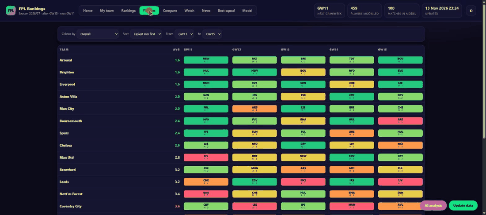
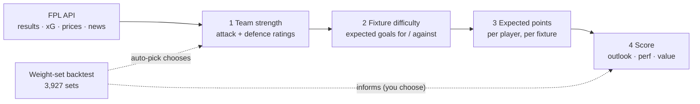
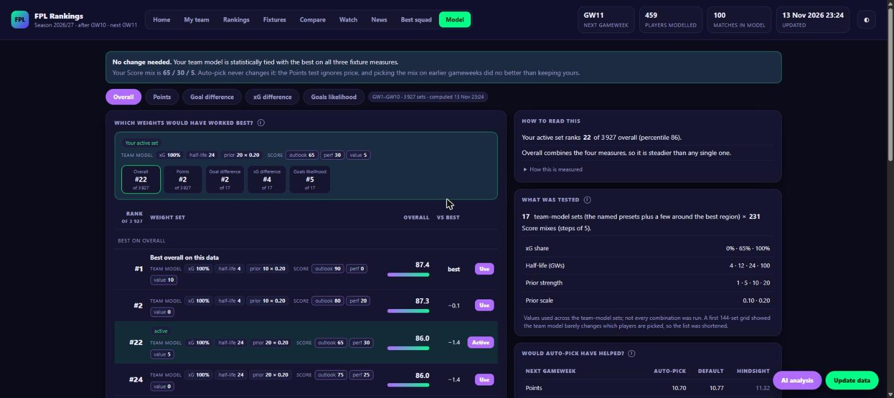

<div align="center">

# ⚽ FPL Rankings

**Fantasy Premier League player rankings in a single offline HTML page, built from the free official FPL API.**


[](LICENSE)
[](https://github.com/dashzinho/fpl-ranker/actions/workflows/tests.yml)




<sub>A quick tour: the fixture ticker, the Model tab (every measure), then Rankings.</sub>

</div>

Everything (fetching, team-strength model, expected points, ranking, backtests, HTML) is deterministic Python.

## About

I built this to answer two questions FPL's own tools don't: **which fixtures are really easy right now**, and **which model settings would actually have worked**. FPL's difficulty rating is a coarse 2-5 number that doesn't move with form, so this fits its own team-strength model on results and xG, turns that into expected points per player, and then **backtests its own settings on past gameweeks** instead of asking you to trust them.

- 🔒 **Local and private.** One HTML page on your machine. No account, no hosted service, no tracking. It only talks to FPL's public API and a few news RSS feeds; your login is never handled (the optional team sync is a bookmarklet that posts only to `127.0.0.1`).
- 🧮 **No AI needed.** The model is plain, deterministic Python (numpy + scipy). An optional Claude Code skill adds news-based suggestions, and it is opt-in.
- 🎯 **Honest about uncertainty.** Near-ties are labelled as ties, the backtest shows its own noise, and nothing changes your settings unless you choose it (or turn on auto-pick).

**Requirements:** Python 3 (developed and tested on 3.14, Windows 11; macOS and Linux should work via `python fpl.py`, but are untested). The first run installs `numpy` and `scipy` for you. No API key.

## Contents

- [About](#about)
- [Quick start](#-quick-start)
- [What it does](#-what-it-does)
- [How the model works](#-how-the-model-works) · full detail in [docs/MODEL.md](docs/MODEL.md)
- [The Model tab and the backtest](#-the-model-tab-and-the-backtest)
- [Auto-pick](#-auto-pick)
- [Preferences](#-preferences)
- [Pages](#-pages) · [Things worth knowing](#-things-worth-knowing) · [Layout](#-layout) · [One-click mode](#-one-click-mode-update-button) · [Notes](#-notes) · [Contributing](#-contributing) · [Disclaimer](#disclaimer) · [License](#license)

---

## 🚀 Quick start

```
python fpl.py --open
```

First run sets itself up (creates `data/` and `output/`, installs `numpy` and `scipy`, writes a default `prefs.json`) and builds `output/fpl_rankings.html`. Later runs are update mode:

| Situation | What happens |
|---|---|
| Last check was less than `min_refresh_minutes` ago | no network at all |
| Nothing changed (results, prices, injury news) | fetches ~2 MB, prints "Up to date", rebuilds nothing |
| Something changed | re-fetches only the players whose minutes/points changed, rebuilds |
| A gameweek has just finished (all matches done) | also re-runs the weight-set backtest (about 5 s, once) and, if auto-pick is on, adopts the best team-model set |

**Flags:** `--force` (rebuild anyway) · `--offline` (cached data only) · `--open` (open the page) · `--serve` (local server with the Update button) · `--backtest` (print the backtest report)

> [!WARNING]
> `--offline` skips fetching your FPL team and reuses your last saved squad (marked as saved on the page). With no saved squad yet, Home and My team stay empty until you update online (the Update button, or plain `python fpl.py`).

## ✨ What it does

| | |
|---|---|
| 🏟️ **Team strength model** | Poisson attack/defence ratings fitted on finished matches, from a mix of xG and goals, recent matches weighing more. FPL's coarse 2-5 strength is only a prior that fades as matches are played, so a team expected to be bad that is performing well stops counting as an easy fixture. Home advantage is fitted too. |
| 🎯 **Expected points** | Per fixture, for every player: appearance, goals, assists (xG/xA blended with actual output, shrunk toward the position average), clean sheets, goals conceded, saves, bonus, defensive contribution and cards, scaled by the fixture model and a minutes/availability model. Blank and double gameweeks are handled automatically. |
| 📈 **Ranking** | Composite score = weighted percentiles (within each position) of projected points over a look-ahead window, season performance index, and points per £. Weights and horizon are adjustable live in the page. |
| 🧪 **Backtest of all of it** | The Model tab re-runs the whole pipeline for every finished gameweek on earlier data only, and scores 3,927 combinations of settings. It can adopt the best team model for you after each gameweek (auto-pick), and tests whether that actually helps. |
| 🗂️ **Page tabs** | Overview (top 8 per position), Rankings (filters, sortable, expandable breakdown per player), Teams & fixtures (current vs preseason rating, difficulty grid), Best squad (integer-programming optimiser: budget, 3 per club, valid formation), My team (swap suggestions, needs `fpl_team_id`), Model (the backtest). More under [Pages](#-pages). |

---

## 🧠 How the model works

Four layers, each feeding the next. The weight-set backtest then measures how well different settings of all of it would have done, and can choose them.



1. **Team strength.** Every team gets an attack and a defence rating from a Poisson model fitted on finished matches. Four settings shape it:

   | Setting | Default | In one line |
   |---|---|---|
   | `xg_weight` | 0.65 | share of xG (vs actual goals) in what each match is scored on |
   | `half_life_gw` | 12 | a match's weight halves every this many gameweeks |
   | `prior_strength` | 5.0 | how long ratings stay pulled toward FPL's own strength ratings |
   | `prior_scale` | 0.10 | how large those prior ratings are |

2. **Fixture difficulty.** Each upcoming fixture gets expected goals for and against. The 1-5 colour is a quantile bucket across all fixtures (green = easiest fifth), available as *attack*, *defence* or *overall*. It replaces FPL's own, form-blind difficulty rating.
   <div align="center">
   

   <sub>Every cell is coloured by the model's expected goals, not FPL's official rating.</sub>
   </div>

3. **Expected points.** Per player and fixture: appearances, goals, assists, clean sheets, bonus, cards and more, scaled by the fixture model and a minutes/availability model.
4. **The Score.** A weighted blend of three within-position percentiles: **outlook** (projected points), **perf** (season performance) and **value** (points per £). Default weights **60 / 25 / 15**.

> [!NOTE]
> On this season's ten gameweeks the lead over FPL's official difficulty was too small to see. Over **112 gameweeks of the last three seasons** it is clear: the model ranks fixtures by the real goal difference at **+0.47 vs +0.35** (gap **+0.12 ± 0.02**, ahead in 79 of 112 gameweeks). See [More data: past seasons](docs/MODEL.md#more-data-past-seasons).

📖 **Formulas, every setting and the reasoning: [docs/MODEL.md](docs/MODEL.md).**

---

## 🧪 The Model tab and the backtest

<div align="center">


<sub>The Model tab: your active set pinned at the top with its rank on every measure, then the best sets and the named presets.</sub>
</div>

The question it answers: ***which settings would have worked best so far?*** It re-runs the pipeline for every finished gameweek **using only data from before that gameweek**, then scores it on what actually happened. Nothing from the future leaks in.

- **A set is seven numbers:** the four team-model settings plus the three Score weights. 17 team-model sets × 231 Score mixes = **3,927 sets**, each backtested (about 5 seconds, once per gameweek).
- **Four measures:**

  | Measure | What it checks |
  |---|---|
  | **Points** | realised points of the top picks over the next 3 gameweeks (ignores price, so it always favours a low `value` weight) |
  | **Goal difference** | how well fixture ease ranked each gameweek's fixtures by the real goal difference |
  | **xG difference** | the same against xG difference (less noisy) |
  | **Goals likelihood** | how likely the real goals were under the set's expected goals |

- **Overall** is a set's mean percentile across the four. No set wins every measure, so the best Overall set is usually not #1 on any one: a set strong everywhere beats one perfect on a single measure.
- **Rank vs tied.** Rank is the exact order. *Tied with best* means the gap is under twice the gameweek-to-gameweek noise, so the data cannot separate them; *behind* means clearly worse. A set ranked #6 can be tied with #1.
- **A plain-English verdict** at the top says whether your team model is tied with the best, and the page also tests auto-pick itself and checks the clean-sheet probabilities (see below).
- **Use** on a row saves that whole set and rebuilds the page. **Save my sliders** saves just the Score weights. Both need `start.bat`.

> [!CAUTION]
> One season, a handful of gameweeks, today's prices, and the best of thousands of sets on the same data is flattered. Treat a tie as a tie.

📖 **How each measure is computed, the worked Overall example and how the noise is calculated: [docs/MODEL.md](docs/MODEL.md#the-backtest-weight-sets).** `python fpl.py --backtest` prints the same in the terminal.

## 🤖 Auto-pick

When a gameweek has fully finished (all matches done, FPL's `finished` flag), the first update after it re-runs the backtest and, if **auto-pick** is on, adopts the best **team-model** set as the new default. It runs **once per finished gameweek** (recorded in `data/auto_pick.json`), never in the middle of a gameweek. It changes only the four team-model settings; **your Score weights are never changed automatically**, because the Points test ignores price and picking the mix on earlier gameweeks did no better than keeping yours.

| Control | Behaviour |
|---|---|
| **Auto-pick switch** | On by default. Choosing a set or saving your sliders yourself turns it off, so your choice is never overwritten. The switch on the Model tab turns it back on. Or set `"auto_pick": false` in `prefs.local.json`. |
| **Pick best now** | Adopts the best team model once, right away, even with auto-pick off. |
| **Revert last pick** | Puts back the values the last pick replaced and turns auto-pick off. Every pick is logged. |

> [!NOTE]
> **Did it help?** Tested by choosing on earlier gameweeks only and scoring on the next one (GW6 to GW10): auto-pick improved the fixture measures (xG difference +0.10 ± 0.06) and made no clear difference to Points. Five test gameweeks is very little, so it is encouraging, not proof. See [the walk-forward test](docs/MODEL.md#would-auto-pick-have-helped-walk-forward).

---

## 🔧 Preferences

<details>
<summary><code>prefs.json</code>, overridden by <code>prefs.local.json</code> (click to expand)</summary>

| Key | Meaning |
|---|---|
| `default_horizon`, `horizon_max` | look-ahead gameweeks (default 5, max 8) |
| `weights` | `outlook` / `perf` / `value` Score weights |
| `budget` | squad budget for the optimiser (default 100.0) |
| `fpl_team_id` | your FPL team id (the number in the URL on the Points page); enables "My team" |
| `min_refresh_minutes` | skip the network if checked more recently than this |
| `xg_weight`, `half_life_gw`, `prior_strength`, `prior_scale` | team-model settings (explained above) |
| `perf_min_minutes` | minutes before a player's season performance is trusted over the average |
| `auto_pick` | `true` (default) / `false`: adopt the best backtested set after each finished gameweek |

Private settings (your team id, and whatever the Model tab or auto-pick saves) live in `prefs.local.json` (git-ignored); `prefs.json` stays shareable.

</details>

## 📄 Pages

<details>
<summary>What is on each tab (click to expand)</summary>

- **Home**: deadline countdown, team rating (your squad vs the best your budget could buy), what to change this week (lineup, captain, best transfer with a noise label, chip), squad alerts, headlines on your players, AI summary.
- **My team**: *Lineup* (best XI, formation, bench order, captain from your 15), *Transfers* (click a player, press Plan; hit worked out from your free transfers; best 1/2/3-transfer plans), *Planner* (multi-gameweek plan: transfers per week, free transfers rolling forward, chips; "Suggest plan" in a conservative/optimised/aggressive style; never-sell / never-buy lists; bench weights), *Chips & Free Hit* (per-gameweek table and the Free Hit squad), *AI*, *History & sync*.
- **Rankings**, **Fixtures** (ticker sortable by overall/attack/defence, any gameweek range), **Compare** (2-3 players), **Watch** (yellow-card bans, DefCon hitters, observed price changes, transfer momentum), **News**, **Best squad**, **Model** (the backtest above).
- Hover any parameter, column, tag or stat for an explanation (or tab to the "i" icons).

</details>

## 💡 Things worth knowing

<details>
<summary>Suspensions, noise, syncing your team, news, AI analysis (click to expand)</summary>

- **Suspension risk**: players on 4 yellow cards (and 9) are discounted by the chance they are banned (5 yellows by GW19 = 1 match, 10 by GW32 = 2); shown as a yellow-card tag with the ban chance.
- **Noise**: the backtest shows about 2 points of error per player per gameweek, so gains under about 3 points are labelled "within noise". Planner defaults to the conservative style.
- **Sync FPL team**: exact squad, selling prices, chips left and free transfers need your login. Serve the page (`start.bat`), drag the *Sync FPL team* button (History & sync) to your bookmarks bar and click it while logged in at fantasy.premierleague.com. It posts only to 127.0.0.1 (origin-checked, your team id only) and rebuilds. Fallback: it downloads `my_team_raw.json`; run `python fpl.py --import-snapshot <file>`.
- **News**: public RSS headlines (BBC Sport, Guardian, Sky Sports, FF Scout, r/FantasyPL when it answers), men's Premier League only, matched to players by name. Headlines and links only; not private leaks, and not fed into the projections.
- **AI analysis** (My team > AI, needs `start.bat`): the button runs the Claude Code skill `fpl-ai-insights` (`.claude/skills/`) headlessly with Read of `data/ai_context.json` and Write of `data/ai_insights.json` only (no web, no shell). The page validates every field (ids exist, multipliers 0.2-1.2, each adjustment must cite a real headline) before showing it. Adjustments are opt-in (checkbox) and change xPts everywhere when on. About 25 seconds and roughly $0.35 of Claude usage per run.
- **Model tab**: see [the section above](#-the-model-tab-and-the-backtest). "Use", "Save my sliders", the auto-pick switch and "Pick best now" need `start.bat`; nothing changes unless you choose it or auto-pick is on.
- `python -m unittest discover -s tests` runs the logic tests (bans, free transfers, sell prices, snapshot, AI validation, news filter, weight sets, walk-forward, auto-pick, saved squad) and a syntax check of the page script; the same runs in CI on every push.

</details>

## 📁 Layout

```
fpl.py          entry point (setup + update logic)
requirements.txt numpy, scipy
tools/          multi_season.py (re-scores the team model on past seasons)
tests/          unit tests and a syntax check of the page script (run in CI)
LICENSE         MIT
CONTRIBUTING.md how to report bugs and send pull requests
prefs.json      preferences
app/            fpl_data.py (API + cache), fpl_model.py (team strength + expected points), backtest.py (accuracy,
                official-FDR comparison, 3.9k weight sets), autopick.py, fpl_report.py, fpl_extra.py, fpl_news.py,
                server.py, board_template.html
docs/           MODEL.md (full model + backtest explanation), demo.gif and screenshots used in this README
data/           cached API data, state.json, backtest.json, backtest_sets.json/.npz, auto_pick.json, my_team_cache.json,
                fdr_history.json, history/ (git-ignored)
output/         fpl_rankings.html (git-ignored, data embedded)
```

## 👆 One-click mode (Update button)

Double-click `start.bat` (or run `python fpl.py --serve --open`). It serves the page on localhost and shows an **Update data** button in the corner: one click runs the same update flow and reloads the page, so you never need an editor or terminal. The server binds to 127.0.0.1 only and the page works read-only if opened directly as a file (the button only appears when served). The Model tab's "Use", "Save my sliders", auto-pick switch and "Pick best now" also need it.

## 📝 Notes

- Data source: the official FPL API (unofficial but free, no key). Selling prices need a login, so "My team" uses current prices.
- Projections, not guarantees. The weights are backtested on this season only (see the [limits](docs/MODEL.md#rank-ties-and-noise)). For a longer test, past-season data is at [vaastav/Fantasy-Premier-League](https://github.com/vaastav/Fantasy-Premier-League).
- Works as a Claude Code skill (`/fpl-rankings`), but needs no AI to run; a news layer could write adjustments to a file the model reads.

## 🤝 Contributing

Issues and pull requests are welcome; see [CONTRIBUTING.md](CONTRIBUTING.md). Model changes should come with a before/after of `python fpl.py --backtest`. Please never paste your FPL team id or login into an issue.

## Disclaimer

This is an unofficial fan project. It is **not affiliated with, endorsed by or connected to the Premier League or Fantasy Premier League**. It reads FPL's public, undocumented API, which can change or be rate-limited without notice; the app caches data and only re-fetches what changed to keep its requests light. Projections are estimates, not guarantees, and not betting or financial advice.

## License

[MIT](LICENSE) © 2026 André Santos. The data comes from the official FPL API and public news feeds, which remain subject to their own terms.
