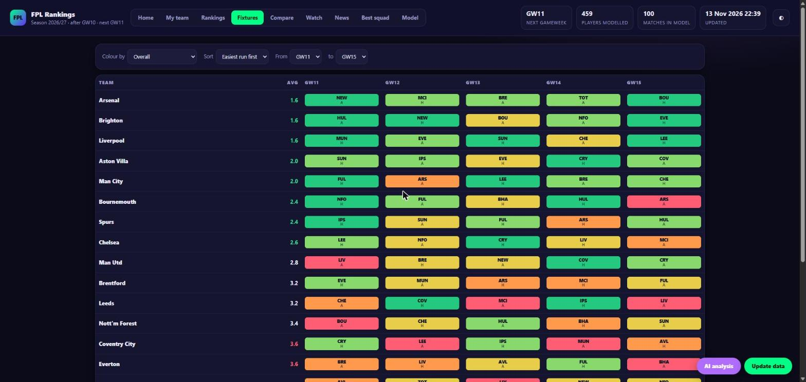
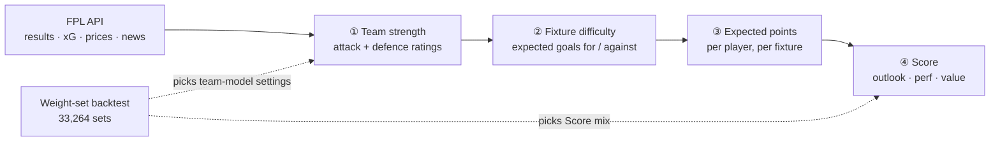

<div align="center">

# ⚽ FPL Rankings

**Fantasy Premier League player rankings in a single offline HTML page, built from the free official FPL API.**




<sub>The fixture ticker: every cell is coloured by the app's own team-strength model, not FPL's official difficulty.</sub>

</div>

Everything (fetching, team-strength model, expected points, ranking, backtests, HTML) is deterministic Python.

## Contents

- [Quick start](#-quick-start)
- [What it does](#-what-it-does)
- [How the model works](#-how-the-model-works)
- [The Model tab: weight sets and the backtest](#-the-model-tab-weight-sets-and-the-backtest)
- [Auto-pick](#-auto-pick)
- [Preferences](#-preferences)
- [Pages](#-pages) · [Things worth knowing](#-things-worth-knowing) · [Layout](#-layout) · [One-click mode](#-one-click-mode-update-button) · [Notes](#-notes) · [License](#license)

---

## 🚀 Quick start

```
python fpl.py --open
```

First run sets itself up (creates `data/` and `output/`, installs `numpy` and `scipy`, writes a default `prefs.json`) and builds `output/fpl_rankings.html`. Later runs are update mode:

| Situation | What happens |
|---|---|
| Last check was less than `min_refresh_minutes` ago | no network at all |
| Nothing changed (results, prices, injury news) | fetches ~2 MB, prints "Up to date", rebuilds nothing |
| Something changed | re-fetches only the players whose minutes/points changed, rebuilds |
| A gameweek has just finished (all matches done) | also re-runs the weight-set backtest (about 40 s, once) and, if auto-pick is on, adopts the best set |

**Flags:** `--force` (rebuild anyway) · `--offline` (cached data only) · `--open` (open the page) · `--serve` (local server with the Update button) · `--backtest` (print the backtest report)

> [!WARNING]
> `--offline` also skips fetching your FPL team, so **Home and My team come out empty**. Update online (the Update button, or plain `python fpl.py`) to get them back.

## ✨ What it does

| | |
|---|---|
| 🏟️ **Team strength model** | Poisson attack/defence ratings fitted on finished matches, from a mix of xG and goals, recent matches weighing more. FPL's coarse 2-5 strength is only a prior that fades as matches are played, so a team expected to be bad that is performing well stops counting as an easy fixture. Home advantage is fitted too. |
| 🎯 **Expected points** | Per fixture, for every player: appearance, goals, assists (xG/xA blended with actual output, shrunk toward the position average), clean sheets, goals conceded, saves, bonus, defensive contribution and cards, scaled by the fixture model and a minutes/availability model. Blank and double gameweeks are handled automatically. |
| 📈 **Ranking** | Composite score = weighted percentiles (within each position) of projected points over a look-ahead window, season performance index, and points per £. Weights and horizon are adjustable live in the page. |
| 🧪 **Backtest of all of it** | The Model tab re-runs the whole pipeline for every finished gameweek on earlier data only, and scores 33,264 combinations of settings. It can adopt the best one for you after each gameweek (auto-pick). |
| 🗂️ **Page tabs** | Overview (top 8 per position), Rankings (filters, sortable, expandable breakdown per player), Teams & fixtures (current vs preseason rating, difficulty grid), Best squad (integer-programming optimiser: budget, 3 per club, valid formation), My team (swap suggestions, needs `fpl_team_id`), Model (the backtest). More under [Pages](#-pages). |

---

## 🧠 How the model works

Four layers, each feeding the next. The weight-set backtest then measures how well different settings of all of it would have done, and can choose them.



### ① Team strength &nbsp;<sub>`app/fpl_model.py` · `fit_teams`</sub>

Every team gets an **attack** and a **defence** rating, fitted on all finished matches with a Poisson model. The expected goals a team scores against an opponent are

```
goals(team vs opp) = mu x exp( attack[team] + defence[opp] + home_adv/2 x (+1 at home, -1 away) )
```

`mu` is the league-average goals per team per match. A positive attack rating means the team scores more than average; a positive defence rating means it concedes more than average. The page shows these as multipliers (`Attack x`, `Defence x`; for defence, below 1.00 is good).

The fit minimises a weighted Poisson loss. Four settings control it:

| Setting | Default | What it does |
|---|---|---|
| `xg_weight` | 0.65 | What each match is scored on. A team's fit target in a match is `xg_weight x its xG + (1 - xg_weight) x its actual goals`. xG is less lucky than goals, so a mostly-xG target is steadier. `1.0` = xG only, `0.0` = goals only. Team xG is the sum of its players' xG. |
| `half_life_gw` | 12 | Recency. A match's weight halves every `half_life_gw` gameweeks, so last week counts more than GW1. `4` is very reactive, `100` makes every match count about the same. |
| `prior_strength` | 5.0 | How hard ratings are pulled toward FPL's own strength ratings (a ridge penalty of `0.7 x prior_strength`). Early in the season there are few matches, so the prior dominates; as results accumulate, the evidence outweighs it. Higher = trusts FPL's ratings for longer. |
| `prior_scale` | 0.10 | How large the prior ratings are. FPL's overall strength (1-5, averaged over home and away) becomes a prior of `prior_scale` per strength point around 3.2 (attack up and defence down for strong teams). |

Home advantage is fitted too, shrunk toward 0.2 in log terms (about x1.2 goals), and the ratings are centred so they stay comparable. The "vs FPL prior" column on the Fixtures tab shows how far each team has moved from its starting rating.

### ② Fixture difficulty

For every upcoming fixture the model predicts goals for (`lt`) and against (`lo`). Everything on the Fixtures tab and in the player projections comes from those two numbers: clean-sheet chance, goals conceded and attacking returns.

The 1-5 colour is a **quantile bucket across all upcoming fixtures**, not a fixed threshold: 1 (green) is the easiest fifth, 5 (red) the hardest fifth. There are three versions, and the ticker can colour and sort by any of them:

| View | Ranked by | Answers |
|---|---|---|
| **Attack** | `lt` | how many goals you should score |
| **Defence** | `lo` | how few you should concede |
| **Overall** | `log(lt / lo)` | the balance of the two |

This replaces FPL's official fixture difficulty rating (FDR), a coarse number that does not move with form. The backtest scores the model against the official rating on the same results.

> [!NOTE]
> At GW10 the model was slightly ahead of the official FDR (rank correlation of ease with goal difference **+0.415** against **+0.349**, pooled), but the gap was inside the noise. Treat it as a tie, not a win.

### ③ Expected points

Per player and fixture: appearance points, goals and assists (xG and xA blended with actual output and shrunk toward the position average), clean sheets, goals conceded, saves, bonus, defensive contribution and cards, scaled by the fixture model and a minutes/availability model (injury and suspension flags, yellow-card ban risk). Summing over the look-ahead window gives the projected points.

### ④ The Score &nbsp;<sub>`outlook` / `perf` / `value`</sub>

The Score ranks players within each position as a weighted blend of three percentiles:

| Part | Meaning |
|---|---|
| **outlook** | projected points over the look-ahead window (the model above) |
| **perf** | season performance index: points per 90, xG+xA per 90, bonus, defensive contributions, shrunk toward average for players with few minutes |
| **value** | projected points per £ of price |

The three weights (default **60 / 25 / 15**) are adjustable live with the sliders on the Rankings tab.

---

## 🧪 The Model tab: weight sets and the backtest

<div align="center">


<sub>The Model tab: your active set pinned at the top with its rank on every measure, then the best sets and the named presets.</sub>
</div>

The question it answers: ***which settings would have worked best so far?*** It runs the pipeline again for every finished gameweek **using only data from before that gameweek**: team ratings fitted on earlier matches, player histories cut, season stats recomputed from the cut data, injury flags neutral (past news is not stored). It then scores the result on what actually happened. Nothing from the future leaks in.

### What a "set" is

A set is seven numbers: the four team-model settings plus the three Score weights.

| Setting | Values tested |
|---|---|
| `xg_weight` | 0, 0.65, 1.0 |
| `half_life_gw` | 4, 12, 24, 100 |
| `prior_strength` | 1, 5, 10, 20 |
| `prior_scale` | 0.05, 0.10, 0.20 |
| Score mix | outlook / perf / value in steps of 5 summing to 100 (231 mixes) |

**144** team-model sets × **231** Score mixes = **33,264 sets**, each backtested.

### The four measures

| Measure | What it checks | Depends on |
|---|---|---|
| **Points** | realised points over the next 3 gameweeks of the top-ranked players per position (3 GKP, 8 DEF, 8 MID, 5 FWD, the same picks Overview shows), averaged over gameweeks. Starts at GW4 because the player model needs history. | team model **and** Score mix |
| **Goal difference** | how well the set's fixture ease ranked each gameweek's fixtures by the real goal difference (Spearman rank correlation, averaged over gameweeks) | team model only |
| **xG difference** | the same against the xG difference, which is less noisy than the score | team model only |
| **Goals likelihood** | the average log-probability of the goals each team really scored under the set's expected goals (closer to 0 is better); rewards calibrated expected goals, not only a good ranking | team model only |

The last three ignore the Score mix, so there are only **144 distinct scores** for them, each repeated for all 231 mixes. That is why those views rank "of 144" and Points ranks "of 33,264".

### Overall

**Overall** is a set's **mean percentile across the four measures** (100 = the best set on that measure). It is a per-set average of how the set ranks on each measure, not an average of models.

No set wins every measure, so the best Overall set is usually not #1 on any single one. A toy example:

| | Points | Goal diff | xG diff | Likelihood | **Overall** |
|---|---|---|---|---|---|
| Set A | 100 | 60 | 50 | 55 | 66 |
| Set B | 99 | 99 | 96 | 94 | **97** ← wins |

Set B wins none of the four, but it is strong on all of them. Overall weights the four measures equally, so it leans toward team-model quality (three of the four); points count for a quarter.

### Rank, ties and noise

- **Rank** is the exact order of the averages on the selected measure (equal scores share a rank).
- **Gap and noise.** For each finished gameweek, take (the best set's score) minus (this set's score). The **gap** is the average of those numbers; the **noise** is their standard error (spread divided by the square root of the number of gameweeks). It says how much the gap would wobble from one gameweek to the next. The page also shows the gap as a multiple of the noise.

| Gap compared with the noise | Label | Meaning |
|---|---|---|
| under 2× | 🟢 **tied with best** | the data cannot tell the set from the best; the order inside a tied group is not meaningful, so a set ranked #6 can be tied with #1 |
| over 2× | 🟠 **behind** | the set is clearly worse on this measure |

- **Stability:** do odd and even gameweeks rank the sets alike? Low means the ordering is mostly noise.

> [!CAUTION]
> Honest limits: one season, a handful of gameweeks, overlapping 3-gameweek windows (so the real noise is larger than shown), prices are today's, and the best of 33,264 sets on the same data is flattered. Treat a tie as a tie and re-check as the season goes on. xG-heavy team-model sets are partly judged on the quantity they fit.

### Using it

The page shows your **active set** with its rank on every measure, then the best sets on the selected measure and the named presets (Default, Trust FPL ratings, Results first, Recent form, Season-long, xG only, Goals only, Outlook only, Value tilt), with FPL's official difficulty as a reference row.

- **Use** on a row saves that whole set (team model and Score weights) to `prefs.local.json` and rebuilds, so difficulty colours, projections, Rankings and squad picks all change.
- **Save my sliders as default** saves just the Score weights.
- Both need `start.bat` (the page is served locally).

`python fpl.py --backtest` prints the same in the terminal: projection accuracy, the model-vs-official-FDR comparison (including an attack/defence split and mean goal difference per difficulty bucket) and the best sets on every measure. Results are cached and recomputed only when a gameweek finishes or the model code changes.

## 🤖 Auto-pick

When a gameweek has fully finished (all matches done, FPL's `finished` flag), the first update after it re-runs the backtest and, if **auto-pick** is on, adopts the best-**Overall** set as the new default. It runs **once per finished gameweek** (recorded in `data/auto_pick.json`), never in the middle of a gameweek.

| Control | Behaviour |
|---|---|
| **Auto-pick switch** | On by default. Choosing a set or saving your sliders yourself turns it off, so your choice is never overwritten. The switch on the Model tab turns it back on (and picks again at the next run). Or set `"auto_pick": false` in `prefs.local.json`. |
| **Pick best now** | Adopts the best set once, right away, even with auto-pick off, and leaves the switch alone. |

> [!NOTE]
> With this much choice and this little data, the best set can change from week to week.

---

## ⚙️ Preferences

<details>
<summary><code>prefs.json</code>, overridden by <code>prefs.local.json</code> (click to expand)</summary>

| Key | Meaning |
|---|---|
| `default_horizon`, `horizon_max` | look-ahead gameweeks (default 5, max 8) |
| `weights` | `outlook` / `perf` / `value` Score weights |
| `budget` | squad budget for the optimiser (default 100.0) |
| `fpl_team_id` | your FPL team id (the number in the URL on the Points page); enables "My team" |
| `min_refresh_minutes` | skip the network if checked more recently than this |
| `xg_weight`, `half_life_gw`, `prior_strength`, `prior_scale` | team-model settings (explained above) |
| `perf_min_minutes` | minutes before a player's season performance is trusted over the average |
| `auto_pick` | `true` (default) / `false`: adopt the best backtested set after each finished gameweek |

Private settings (your team id, and whatever the Model tab or auto-pick saves) live in `prefs.local.json` (git-ignored); `prefs.json` stays shareable.

</details>

## 📄 Pages

<details>
<summary>What is on each tab (click to expand)</summary>

- **Home**: deadline countdown, team rating (your squad vs the best your budget could buy), what to change this week (lineup, captain, best transfer with a noise label, chip), squad alerts, headlines on your players, AI summary.
- **My team**: *Lineup* (best XI, formation, bench order, captain from your 15), *Transfers* (click a player, press Plan; hit worked out from your free transfers; best 1/2/3-transfer plans), *Planner* (multi-gameweek plan: transfers per week, free transfers rolling forward, chips; "Suggest plan" in a conservative/optimised/aggressive style; never-sell / never-buy lists; bench weights), *Chips & Free Hit* (per-gameweek table and the Free Hit squad), *AI*, *History & sync*.
- **Rankings**, **Fixtures** (ticker sortable by overall/attack/defence, any gameweek range), **Compare** (2-3 players), **Watch** (yellow-card bans, DefCon hitters, observed price changes, transfer momentum), **News**, **Best squad**, **Model** (the backtest above).
- Hover any parameter, column, tag or stat for an explanation (or tab to the "i" icons).

</details>

## 💡 Things worth knowing

<details>
<summary>Suspensions, noise, syncing your team, news, AI analysis (click to expand)</summary>

- **Suspension risk**: players on 4 yellow cards (and 9) are discounted by the chance they are banned (5 yellows by GW19 = 1 match, 10 by GW32 = 2); shown as a yellow-card tag with the ban chance.
- **Noise**: the backtest shows about 2 points of error per player per gameweek, so gains under about 3 points are labelled "within noise". Planner defaults to the conservative style.
- **Sync FPL team**: exact squad, selling prices, chips left and free transfers need your login. Serve the page (`start.bat`), drag the *Sync FPL team* button (History & sync) to your bookmarks bar and click it while logged in at fantasy.premierleague.com. It posts only to 127.0.0.1 (origin-checked, your team id only) and rebuilds. Fallback: it downloads `my_team_raw.json`; run `python fpl.py --import-snapshot <file>`.
- **News**: public RSS headlines (BBC Sport, Guardian, Sky Sports, FF Scout, r/FantasyPL when it answers), men's Premier League only, matched to players by name. Headlines and links only; not private leaks, and not fed into the projections.
- **AI analysis** (My team > AI, needs `start.bat`): the button runs the Claude Code skill `fpl-ai-insights` (`.claude/skills/`) headlessly with Read of `data/ai_context.json` and Write of `data/ai_insights.json` only (no web, no shell). The page validates every field (ids exist, multipliers 0.2-1.2, each adjustment must cite a real headline) before showing it. Adjustments are opt-in (checkbox) and change xPts everywhere when on. About 25 seconds and roughly $0.35 of Claude usage per run.
- **Model tab**: see [the section above](#-the-model-tab-weight-sets-and-the-backtest). "Use", "Save my sliders", the auto-pick switch and "Pick best now" need `start.bat`; nothing changes unless you choose it or auto-pick is on.
- `python -m unittest discover -s tests` runs the logic tests (bans, free transfers, sell prices, snapshot, AI validation, news filter, weight sets, auto-pick).

</details>

## 🗺️ Layout

```
fpl.py          entry point (setup + update logic)
prefs.json      preferences
app/            fpl_data.py (API + cache), fpl_model.py (team strength + expected points), backtest.py (accuracy,
                official-FDR comparison, 33k weight sets), autopick.py, fpl_report.py, fpl_extra.py, fpl_news.py,
                server.py, board_template.html
docs/           screenshots used in this README
data/           cached API data, state.json, backtest.json, backtest_sets.json/.npz, auto_pick.json (git-ignored)
output/         fpl_rankings.html (git-ignored, data embedded)
```

## 🖱️ One-click mode (Update button)

Double-click `start.bat` (or run `python fpl.py --serve --open`). It serves the page on localhost and shows an **Update data** button in the corner: one click runs the same update flow and reloads the page, so you never need an editor or terminal. The server binds to 127.0.0.1 only and the page works read-only if opened directly as a file (the button only appears when served). The Model tab's "Use", "Save my sliders", auto-pick switch and "Pick best now" also need it.

## 📝 Notes

- Data source: the official FPL API (unofficial but free, no key). Selling prices need a login, so "My team" uses current prices.
- Projections, not guarantees. The weights are backtested on this season only (see the [limits](#rank-ties-and-noise) above). For a longer test, past-season data is at [vaastav/Fantasy-Premier-League](https://github.com/vaastav/Fantasy-Premier-League).
- Works as a Claude Code skill (`/fpl-rankings`), but needs no AI to run; a news layer could write adjustments to a file the model reads.

## License

Copyright (c) 2026 André Santos. All rights reserved. The code is public for viewing only; see [LICENSE](LICENSE). Contact me for permission to use it.
