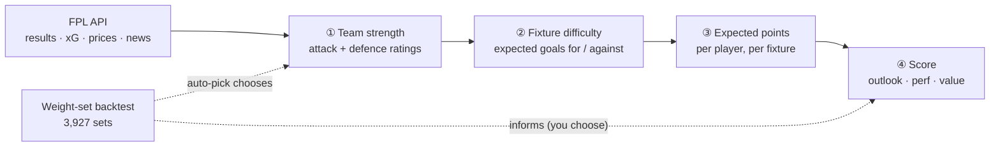
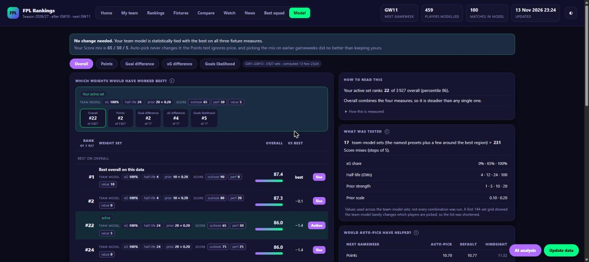

# How the model works and how it is tested

[← Back to the README](../README.md)

This page explains every layer of the FPL Rankings model, and the backtest that scores different settings of it. The README has the short version.

## Contents

- [The model](#the-model): [team strength](#1-team-strength) → [fixture difficulty](#2-fixture-difficulty) → [expected points](#3-expected-points) → [the Score](#4-the-score-outlook--perf--value)
- [The backtest: weight sets](#the-backtest-weight-sets): [what a set is](#what-a-set-is) · [the four measures](#the-four-measures) · [Overall](#overall) · [rank, ties and noise](#rank-ties-and-noise)
- [Auto-pick](#auto-pick): [would it have helped?](#would-auto-pick-have-helped-walk-forward)
- [Clean-sheet calibration](#clean-sheet-calibration)
- [More data: past seasons](#more-data-past-seasons)

## The model

Four layers, each feeding the next. The weight-set backtest then measures how well different settings of all of it would have done, and can choose them.



### 1. Team strength

<sub>Code: `app/fpl_model.py`, `fit_teams`</sub>

Every team gets an **attack** and a **defence** rating, fitted on all finished matches with a Poisson model. The expected goals a team scores against an opponent are

```
goals(team vs opp) = mu x exp( attack[team] + defence[opp] + home_adv/2 x (+1 at home, -1 away) )
```

`mu` is the league-average goals per team per match. A positive attack rating means the team scores more than average; a positive defence rating means it concedes more than average. The page shows these as multipliers (`Attack x`, `Defence x`; for defence, below 1.00 is good).

The fit minimises a weighted Poisson loss. Four settings control it:

| Setting | Default | What it does |
|---|---|---|
| `xg_weight` | 0.65 | What each match is scored on. A team's fit target in a match is `xg_weight x its xG + (1 - xg_weight) x its actual goals`. xG is less lucky than goals, so a mostly-xG target is steadier. `1.0` = xG only, `0.0` = goals only. Team xG is the sum of its players' xG. |
| `half_life_gw` | 12 | Recency. A match's weight halves every `half_life_gw` gameweeks, so last week counts more than GW1. `4` is very reactive, `100` makes every match count about the same. |
| `prior_strength` | 5.0 | How hard ratings are pulled toward FPL's own strength ratings (a ridge penalty of `0.7 x prior_strength`). Early in the season there are few matches, so the prior dominates; as results accumulate, the evidence outweighs it. Higher = trusts FPL's ratings for longer. |
| `prior_scale` | 0.10 | How large the prior ratings are. FPL's overall strength (1-5, averaged over home and away) becomes a prior of `prior_scale` per strength point around 3.2 (attack up and defence down for strong teams). |

Home advantage is fitted too, shrunk toward 0.2 in log terms (about x1.2 goals), and the ratings are centred so they stay comparable. The "vs FPL prior" column on the Fixtures tab shows how far each team has moved from its starting rating.

### 2. Fixture difficulty

For every upcoming fixture the model predicts goals for (`lt`) and against (`lo`). Everything on the Fixtures tab and in the player projections comes from those two numbers: clean-sheet chance, goals conceded and attacking returns.

The 1-5 colour is a **quantile bucket across all upcoming fixtures**, not a fixed threshold: 1 (green) is the easiest fifth, 5 (red) the hardest fifth. There are three versions, and the ticker can colour and sort by any of them:

| View | Ranked by | Answers |
|---|---|---|
| **Attack** | `lt` | how many goals you should score |
| **Defence** | `lo` | how few you should concede |
| **Overall** | `log(lt / lo)` | the balance of the two |

This replaces FPL's official fixture difficulty rating (FDR), a coarse number that does not move with form. The backtest scores the model against the official rating on the same results.

> [!NOTE]
> On this season's ten gameweeks the model's lead over the official FDR was too small to see (+0.415 vs +0.349). Over **112 gameweeks of the last three seasons** it is clear: ease ranks fixtures by the real goal difference at **+0.47 vs +0.35**, a gap of **+0.12 ± 0.02**, ahead in 79 of 112 gameweeks. Details and caveats in [More data: past seasons](#more-data-past-seasons).

### 3. Expected points

Per player and fixture: appearance points, goals and assists (xG and xA blended with actual output and shrunk toward the position average), clean sheets, goals conceded, saves, bonus, defensive contribution and cards, scaled by the fixture model and a minutes/availability model (injury and suspension flags, yellow-card ban risk). Summing over the look-ahead window gives the projected points.

### 4. The Score (`outlook` / `perf` / `value`)

The Score ranks players within each position as a weighted blend of three percentiles:

| Part | Meaning |
|---|---|
| **outlook** | projected points over the look-ahead window (the model above) |
| **perf** | season performance index: points per 90, xG+xA per 90, bonus, defensive contributions, shrunk toward average for players with few minutes |
| **value** | projected points per £ of price |

The three weights (default **60 / 25 / 15**) are adjustable live with the sliders on the Rankings tab.


## The backtest: weight sets

<div align="center">


<sub>The Model tab: a verdict at the top, your active set pinned with its rank on every measure, then the best sets and the named presets.</sub>
</div>

The question it answers: ***which settings would have worked best so far?*** It runs the pipeline again for every finished gameweek **using only data from before that gameweek**: team ratings fitted on earlier matches, player histories cut, season stats recomputed from the cut data, injury flags neutral (past news is not stored). It then scores the result on what actually happened. Nothing from the future leaks in.

### What a "set" is

A set is seven numbers: the four team-model settings plus the three Score weights.

- **Team model:** 17 sets (`xg_weight`, `half_life_gw`, `prior_strength`, `prior_scale`): the seven named presets plus ten around the region that scored best. Values used: `xg_weight` 0 / 0.65 / 1.0, `half_life_gw` 4 / 12 / 24 / 100, `prior_strength` 1 / 5 / 10 / 20, `prior_scale` 0.05 / 0.10 / 0.20. Not every combination is run.
- **Score mix:** outlook / perf / value in steps of 5 summing to 100 (231 mixes).

**17** team-model sets × **231** Score mixes = **3,927 sets**, each backtested in about five seconds.

> [!NOTE]
> The first version ran a full 144-set grid of team models (33,264 sets, 40 seconds). Checking it showed that in the Points measure **87% of the variation came from the Score mix and only 7% from the team model**, and the default and the auto-picked team model produced almost the same player rankings (rank correlation 0.999; 8 of the top 8 defenders, 7 of 8 midfielders, 5 of 5 forwards and 3 of 3 goalkeepers identical). The team model mainly changes the fixture colours, so the list was shortened.

### The four measures

| Measure | What it checks | Depends on |
|---|---|---|
| **Points** | realised points over the next 3 gameweeks of the top-ranked players per position (3 GKP, 8 DEF, 8 MID, 5 FWD, the same picks Overview shows), averaged over gameweeks. Starts at GW4 because the player model needs history. | team model **and** Score mix |
| **Goal difference** | how well the set's fixture ease ranked each gameweek's fixtures by the real goal difference (Spearman rank correlation, averaged over gameweeks) | team model only |
| **xG difference** | the same against the xG difference, which is less noisy than the score | team model only |
| **Goals likelihood** | the average log-probability of the goals each team really scored under the set's expected goals (closer to 0 is better); rewards calibrated expected goals, not only a good ranking | team model only |

The last three ignore the Score mix, so there are only **17 distinct scores** for them, each repeated for all 231 mixes. That is why those views rank "of 17" and Points ranks "of 3,927".

> [!WARNING]
> **Points ignores price.** It scores the top picks with no budget, so it always favours a low `value` weight. Use it to compare team models, not to decide how much price should matter. This is why auto-pick never changes your Score weights.

### Overall

**Overall** is a set's **mean percentile across the four measures** (100 = the best set on that measure). It is a per-set average of how the set ranks on each measure, not an average of models.

No set wins every measure, so the best Overall set is usually not #1 on any single one. A toy example:

| | Points | Goal diff | xG diff | Likelihood | **Overall** |
|---|---|---|---|---|---|
| Set A | 100 | 60 | 50 | 55 | 66 |
| Set B | 99 | 99 | 96 | 94 | **97** ← wins |

Set B wins none of the four, but it is strong on all of them. Overall weights the four measures equally, so it leans toward team-model quality (three of the four); points count for a quarter.

### Rank, ties and noise

- **Rank** is the exact order of the averages on the selected measure (equal scores share a rank).
- **Gap and noise.** For each finished gameweek, take (the best set's score) minus (this set's score). The **gap** is the average of those numbers; the **noise** is their standard error (spread divided by the square root of the number of gameweeks). It says how much the gap would wobble from one gameweek to the next. The page also shows the gap as a multiple of the noise. For Points the noise allows for the 3-gameweek windows overlapping (Newey-West, lag 2), and is never smaller than the plain figure.

| Gap compared with the noise | Label | Meaning |
|---|---|---|
| under 2× | 🟢 **tied with best** | the data cannot tell the set from the best; the order inside a tied group is not meaningful, so a set ranked #6 can be tied with #1 |
| over 2× | 🟠 **behind** | the set is clearly worse on this measure |

- **Stability:** do odd and even gameweeks rank the sets alike? Low means the ordering is mostly noise.

> [!CAUTION]
> Honest limits: one season, a handful of gameweeks, prices are today's, and the best of thousands of sets on the same data is flattered. Treat a tie as a tie and re-check as the season goes on. xG-heavy team-model sets are partly judged on the quantity they fit.

### Using it

At the top, a verdict in plain English says whether your team model is tied with the best on the three fixture measures and states your Score mix. Below it, the page shows your **active set** with its rank on every measure, then the best sets on the selected measure and the named presets (Default, Trust FPL ratings, Results first, Recent form, Season-long, xG only, Goals only, Outlook only, Value tilt), with FPL's official difficulty as a reference row.

- **Use** on a row saves that whole set (team model and Score weights) to `prefs.local.json` and rebuilds, so difficulty colours, projections, Rankings and squad picks all change.
- **Save my sliders as default** saves just the Score weights.
- Both need `start.bat` (the page is served locally).

`python fpl.py --backtest` prints the same in the terminal: projection accuracy, clean-sheet calibration, the model-vs-official-FDR comparison (including an attack/defence split and mean goal difference per difficulty bucket), the best sets on every measure and the walk-forward test. Results are cached and recomputed only when a gameweek finishes or the model code changes.

## Auto-pick

When a gameweek has fully finished (all matches done, FPL's `finished` flag), the first update after it re-runs the backtest and, if **auto-pick** is on, adopts the best **team-model** set as the new default. It runs **once per finished gameweek** (recorded in `data/auto_pick.json`), never in the middle of a gameweek.

- **What it changes:** only the four team-model settings. Your Score weights are never changed automatically (see "Points ignores price" above, and the walk-forward test below).
- **What "best" means:** the highest mean percentile of the four measures among the team-model sets, with Points averaged over every Score mix so the answer does not depend on your weights.

| Control | Behaviour |
|---|---|
| **Auto-pick switch** | On by default. Choosing a set or saving your sliders yourself turns it off, so your choice is never overwritten. The switch on the Model tab turns it back on (and picks again at the next run). Or set `"auto_pick": false` in `prefs.local.json`. |
| **Pick best now** | Adopts the best team model once, right away, even with auto-pick off, and leaves the switch alone. |
| **Revert last pick** | Puts back the team-model values the last pick replaced and turns auto-pick off. |
| **History** | Every pick is logged with the values it replaced (last five shown on the page, last twenty kept). |

### Would auto-pick have helped? (walk-forward)

The fair test: for each test gameweek, choose using **only earlier gameweeks**, then score on that gameweek and compare with simply keeping the default. On this season's data (test gameweeks GW6 to GW10):

| Team model, scored on the next gameweek | Auto-pick minus default |
|---|---|
| xG difference | **+0.103** ± 0.056 (better in 4 of 5) |
| Goal difference | +0.100 ± 0.102 (3 of 5) |
| Goals likelihood | +0.009 ± 0.009 (3 of 5) |
| Points (default Score mix) | −0.07 ± 0.12 (1 of 5): no clear difference |

Picking the **Score mix** the same way did no better than keeping 60 / 25 / 15 (−0.007 ± 0.16 points) and swung between very different mixes, choosing a value weight of 0 in four of five weeks. That is why auto-pick leaves the mix to you.

> [!NOTE]
> Five test gameweeks is very little: only large effects are visible. The team-model result is encouraging (it helps the fixture measures and does not hurt Points) but it is not proof.

### Clean-sheet calibration

Is the model's clean-sheet chance honest? For every finished fixture, P(clean sheet) = `exp(-opponent's expected goals)` under the model fitted on earlier matches, against whether the team really kept one:

| Predicted | 13% | 18% | 22% | 26% | 34% |
|---|---|---|---|---|---|
| **Actual** | 8% | 19% | 36% | 36% | 42% |

Over 180 team-fixtures the model predicts 23% clean sheets and 28% happened; the Brier score is 0.1955 against 0.2031 for always guessing the average, so it has some skill. The gap is about 1.7 times what 180 fixtures can show by chance, so it does **not** yet justify changing the goals model (for example with a Dixon-Coles correction). Re-check as more gameweeks are played.

## More data: past seasons

This season only has ten gameweeks, so `tools/multi_season.py` re-scores the same 17 team-model sets on three past seasons (2022-23, 2023-24, 2024-25: 112 gameweeks) from the public archive [vaastav/Fantasy-Premier-League](https://github.com/vaastav/Fantasy-Premier-League). Only the three team-model measures can be compared: past seasons have no `defensive_contribution` points (introduced in 2025-26), and seasons before 2022-23 have no xG.

```
python tools/multi_season.py        # downloads about 5 MB per season into data/history/ (git-ignored)
```

| | Result over 112 gameweeks |
|---|---|
| **Model vs FPL's official difficulty** | rank correlation of ease with goal difference: model **+0.47** (default) vs official **+0.35**, a gap of **+0.12 ± 0.02**, ahead in 79 of 112 gameweeks. Against xG difference: **+0.50** vs **+0.36**, gap **+0.14 ± 0.015**, ahead in 83 of 112. |
| **Do the settings matter?** | Very little. On xG difference all 17 sets are within noise of each other except two. On goal difference 4 of 17 are tied with the best; the default ranks 13th, 0.025 behind (about 3 times the noise). |
| **Is the ordering stable season to season?** | For goals likelihood, yes: rank correlations between seasons of +0.80 to +0.88. For goal difference, partly (+0.31 to +0.73). For xG difference, no (−0.63 to +0.14): that ordering is mostly noise. |
| **Which direction wins consistently?** | On goals likelihood the best sets all use xG only with a strong pull toward FPL's ratings (`prior_strength` 10 to 20, `prior_scale` 0.20). The default's likelihood is −1.509 against −1.500 for the best: a small gap (0.6%) but about 3.5 times the noise. |

Caveats: the archive stores each fixture's **final** difficulty rating (FPL publishes only the current one; this app now records it as it changes in `data/fdr_history.json`, so future comparisons use what was shown at the time); the official rating is deliberately coarse (2 to 5) and ties cost it some rank correlation, so read this as "clearly better at ranking fixtures", not as a precise margin; and only the team-model measures carry over, not Points.
